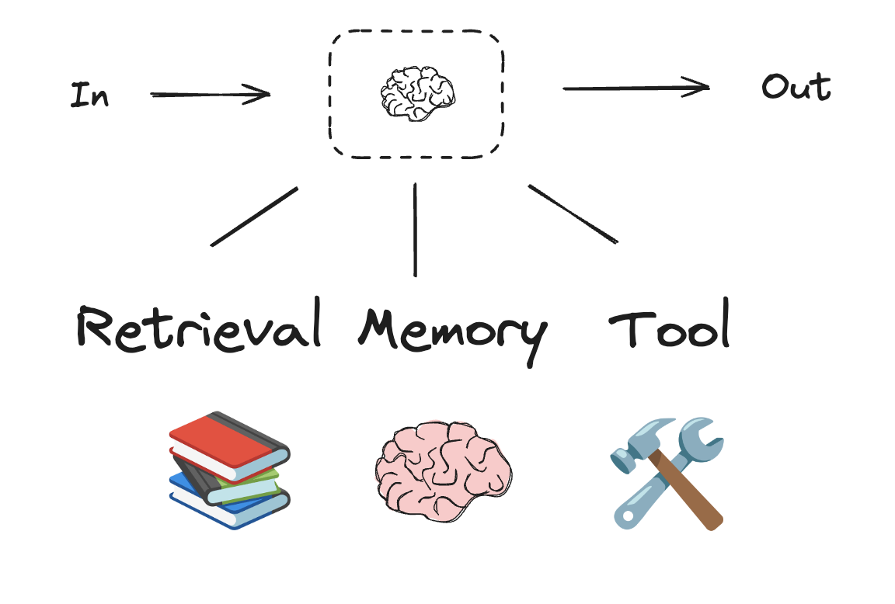
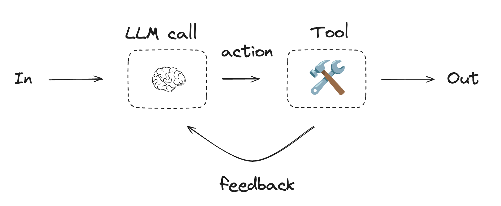
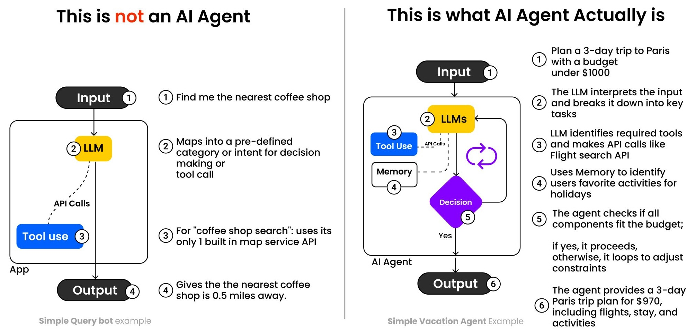
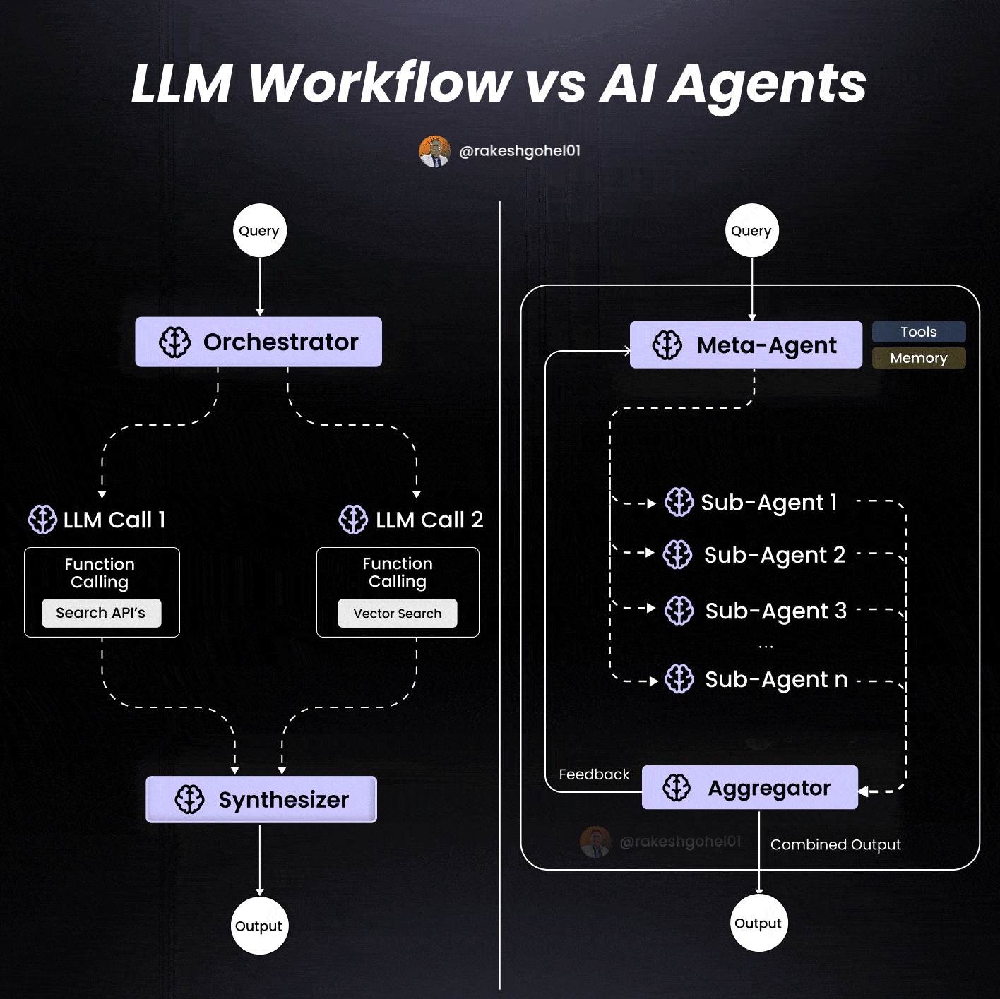
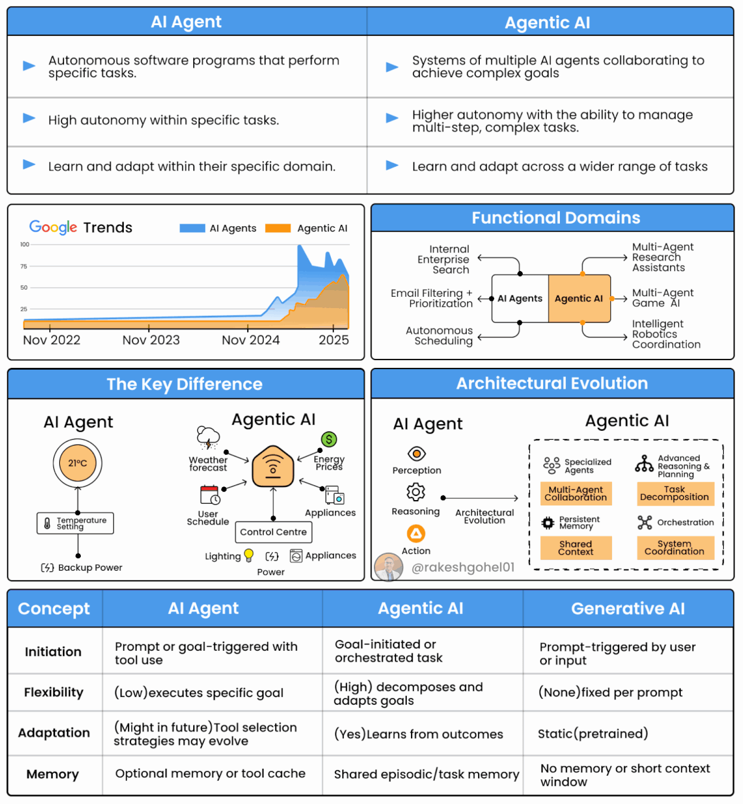
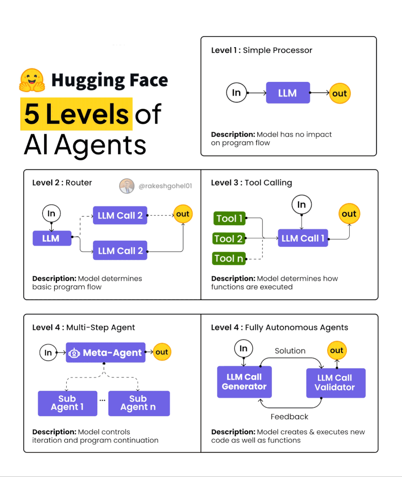
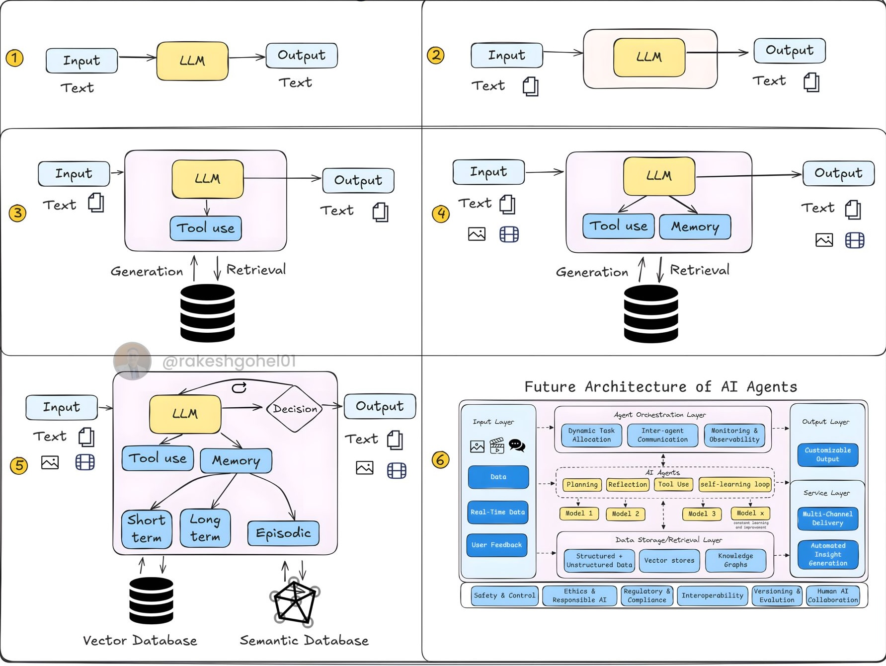

# Agents and Agentic AI Systems

This page is a compact reference for agent definitions and visual notes. For the main conceptual chapter, start with [Agentic AI Foundations](../agentic-ai-foundations.md).

## Core Definition

An AI agent is a model-centered system that can use context, tools, memory, and control flow to pursue a goal.

Useful shorthand:

```text
AI agent = model + instructions + context + tools + memory/state + control loop
```

The practical distinction is whether the system can choose actions based on intermediate feedback.

- **LLM call**: one model request and one response.
- **Workflow**: known steps with limited branching.
- **Agent**: dynamic loop that chooses actions from observations.
- **Agentic system**: product architecture around one or more agents, tools, data, policies, evals, and operations.

## Common Agent Capabilities

- Interpret a user goal or task.
- Inspect context and environment state.
- Select tools or delegate to other agents.
- Execute read or write actions.
- Observe tool results.
- Update task state or memory.
- Ask for human input when needed.
- Stop when the goal is complete or a limit is reached.

Read more:

- [Agentic AI Foundations](../agentic-ai-foundations.md)
- [Agents in AI Engineering](./huyen-agents.md)
- [AI Engineering: Agents](../ai-engineering-summary/Chapter_6_2_Agents.md)

## Tool Use

Tools convert model reasoning into external capability.

| Tool Type | Examples | Risk Level |
|-----------|----------|------------|
| Read tools | Search, retrieval, database reads, file reads, logs | Low to medium |
| Write tools | Email, CRM updates, file edits, ticket creation, payments | Medium to high |
| Execution tools | Code interpreter, shell, browser, workflow runner | High |
| Specialist tools | OCR, calculators, parsers, vector search, SQL engines | Depends on action |
| Other agents | Researcher, coder, reviewer, planner, executor | Depends on delegated tools |

Design rule: the more irreversible the action, the more validation, approval, and auditability the system needs.

## Planning and Control Flow

Agents can use several control patterns:

- **Single tool call**: choose and call one tool.
- **Plan then execute**: generate a plan, validate it, then run steps.
- **ReAct**: reason, act, observe, repeat.
- **Reflection**: generate, critique, revise.
- **Router**: classify and dispatch to a workflow, model, tool, or agent.
- **Supervisor-worker**: one controller delegates to specialists.
- **Human checkpoint**: pause for approval, correction, or escalation.
- **Background agent**: durable long-running task with retries and resumability.

## Visual Notes

These diagrams are useful for quick review and will be reorganized into the system design chapter over time.

### Augmented LLM vs Agent





### Agent vs Workflow





### Agents vs Agentic AI



### Agent Evolution





## Failure Modes

Common failures:

- Invalid plan.
- Wrong tool selected.
- Correct tool called with wrong arguments.
- Tool result misread.
- Agent loops without progress.
- Goal completed incorrectly.
- Unbounded cost or latency.
- Prompt injection through retrieved content or tool output.
- Memory poisoning or stale memory recall.

Evaluate agents by:

- Task success rate.
- Tool-call validity.
- Constraint satisfaction.
- Steps to completion.
- Recovery from tool failures.
- Human escalation quality.
- Cost and latency.
- Trace completeness.

## Chapter Boundary

This page stays short. Detailed architecture, memory, RAG, evaluation, protocols, and production patterns belong in:

- [Chapter 1: Foundations](../README.md)
- [Agentic AI Foundations](../agentic-ai-foundations.md)
- [System Design](../../03_system_design/README.md)
