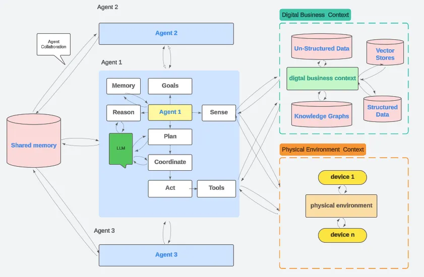

# System Design Architectures

This section contains reusable architecture frameworks for GenAI and agentic systems. Use it after the Foundations chapter and before deep dives into RAG, memory, evals, protocols, and production.

## How to Use This Section

Start with the 12-step framework, then jump into the architecture layer notes or concrete examples.

| Need | Start Here |
|------|------------|
| A repeatable interview/product design method | [12-Step GenAI and Agentic System Design](./ASD-12-step-v1.5.md) |
| A layer-by-layer architecture map | [Agentic AI Architecture Layers](./agentic-arch-layers.md) |
| Durable background agents | [Durable and Background Agents](./durable-background-agents.md) |
| AI-native product architecture | [AI Native Architecture](./ai-native-arch.md) |
| External architecture examples | [NVIDIA Agentic AI](./nvidia-agentic-ai.md), [PhiloAgent](./philoagent_system_architecture.md) |

## Reference Architecture

Most GenAI and agentic products can be described with this architecture skeleton:

```text
client / trigger
  -> API gateway, auth, rate limits
  -> router or orchestrator
  -> context builder
  -> retrieval, memory, tools, and policy services
  -> model gateway or agent runtime
  -> validators, guardrails, and human checkpoints
  -> response/action
  -> traces, evals, metrics, and feedback loops
```

Design quality comes from deciding what each layer owns and where trust boundaries sit.

## Core Architecture Layers

| Layer | Responsibility | Key Questions |
|-------|----------------|---------------|
| Product/API layer | User experience, API contract, auth, rate limits, request lifecycle. | Who is the user, what is the task, and what SLOs matter? |
| Orchestration layer | Routing, workflows, agent loops, queues, retries, background jobs. | Is control deterministic, model-driven, graph-based, or hybrid? |
| Context layer | Prompt construction, retrieval, memory, policies, compression, provenance. | What should the model see and what must be isolated? |
| Model layer | Model selection, routing, fallback, structured outputs, streaming. | Which model is good enough for this task at the target cost and latency? |
| Retrieval/data layer | Ingestion, indexes, ACLs, freshness, citations, deletion. | What is the source of truth and how is it grounded? |
| Tool/action layer | APIs, code/browser tools, side effects, approvals, idempotency. | What can the system do, and what requires approval? |
| Memory/state layer | Session state, task state, user memory, long-term knowledge. | What persists, who owns it, and how is it forgotten? |
| Safety/governance layer | Guardrails, permissions, PII, injection defense, auditability. | What can go wrong and how is blast radius limited? |
| Evals/observability layer | Offline evals, online evals, traces, metrics, feedback, incident response. | How do we know it works and how do we debug failures? |
| Infrastructure layer | Serving, storage, queues, scaling, deployment, cost controls. | How does it meet scale, reliability, and cost targets? |

## Architecture Modes

### 1. Simple Compound GenAI App

Use for chat, summarization, extraction, content generation, and basic assistants.

```text
request -> context builder -> model -> validator -> response -> trace
```

### 2. RAG System

Use when answers depend on external knowledge.

```text
docs -> ingestion -> chunking -> embeddings/indexes
query -> retrieval -> reranking -> grounded prompt -> model -> cited answer
```

### 3. Agentic Workflow

Use when the system must choose tools or actions dynamically.

```text
request -> orchestrator -> plan/act/observe loop -> tools/memory -> guardrails -> answer/action
```

### 4. Durable Background Agent

Use when work continues after the user leaves or runs on a schedule/event.

```text
trigger -> durable task state -> agent worker -> checkpoints -> notifications/approvals -> completion
```

### 5. Multimodal System

Use when inputs include documents, screenshots, images, audio, video, or UI state.

```text
artifact -> parse/perceive -> retrieve/contextualize -> reason -> cite region/page/timestamp -> output/action
```

## Design Review Checklist

- Is the product scope explicit?
- Are success metrics and SLOs defined?
- Is the source of truth clear?
- Are retrieval, memory, and context separated?
- Are tool permissions scoped?
- Are side effects idempotent or approval-gated?
- Are prompt injection and data exfiltration addressed?
- Are offline and online evals specified?
- Are traces sufficient for debugging?
- Is cost per successful task estimated?
- Is there a rollout path from prototype to production?

## Examples and Diagrams



