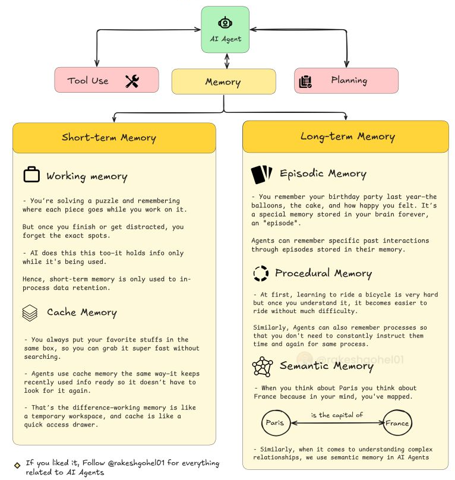
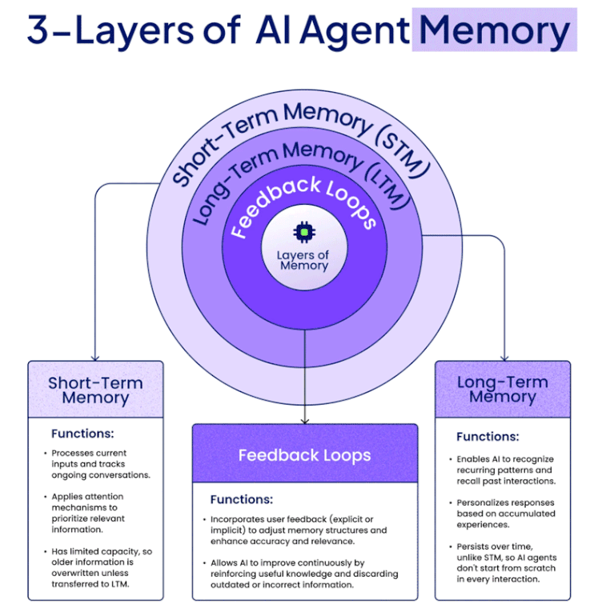
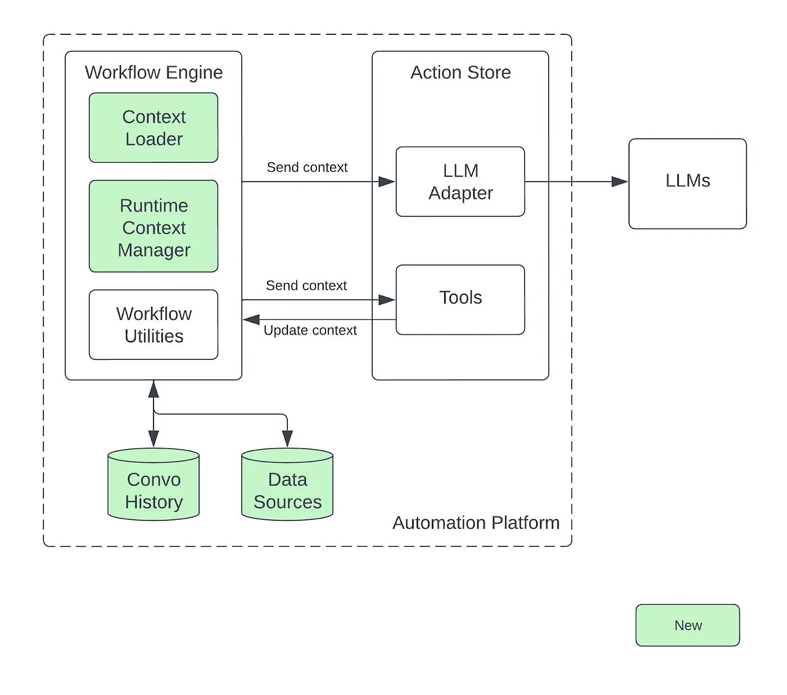

# Memory, State, and Context

Memory in agentic systems is not the same as conversation history. It is a set of product decisions about what persists, who can access it, when it is retrieved, how it is corrected, and how it is deleted.

Use this page to design memory systems for assistants, agents, personalization, long-running tasks, and background workflows.

## Core Distinctions

| Concept | Meaning | Example |
|---------|---------|---------|
| Context | Information included in the current model call. | Retrieved policy snippets, recent messages, tool outputs. |
| State | Durable task/session data owned by the application. | Current plan, ticket status, workflow step, approval state. |
| Memory | Persisted information selected for future use. | User preferences, prior decisions, recurring project facts. |
| Knowledge | External source of truth, usually retrieved. | Docs, databases, tickets, code, policies. |
| Trace | Execution record for debugging, evals, and audit. | Model calls, tool calls, retrieved chunks, memory reads/writes. |

Bad memory design creates privacy risk and context pollution. Good memory design makes the system more useful without hiding what it knows or why.

## Memory Types

| Type | Purpose | Typical Store | Key Risk |
|------|---------|---------------|----------|
| Working memory | Current task state and recent observations. | Orchestrator state, Redis, Postgres. | Context bloat, stale step state. |
| Episodic memory | Past interactions, task traces, outcomes. | Vector DB, trace store, object store. | Irrelevant retrieval, privacy leakage. |
| Semantic memory | Stable facts, preferences, entities, policies. | Relational DB, graph DB, vector DB. | Incorrect facts, conflicts, poisoning. |
| Procedural memory | Reusable skills, playbooks, workflows. | Skill registry, repo, policy store. | Outdated procedures, unsafe actions. |

## Read Path

```text
user/task input
  -> intent and permission check
  -> memory query construction
  -> candidate retrieval
  -> ranking and filtering
  -> provenance and freshness check
  -> context injection or user confirmation
```

Design questions:

- Which memories are allowed for this user, tenant, task, and tool?
- Should retrieval prioritize relevance, recency, authority, confidence, or explicit user pins?
- How much memory fits inside the context budget?
- Should memory be cited, silently used, or confirmed with the user?
- What happens when memory conflicts with current instructions or source-of-truth data?

## Write Path

```text
conversation/tool trace
  -> candidate memory extraction
  -> policy and PII filter
  -> confidence score
  -> conflict detection
  -> user-visible write or approved silent write
  -> retention and deletion policy
```

Design questions:

- What is worth remembering?
- Who can approve, edit, or delete memory?
- Which memories require explicit consent?
- How are memories expired?
- How are secrets, credentials, and sensitive personal data blocked?
- How is prompt-injected content prevented from becoming memory?

## Memory Consolidation

Long-running agents should not keep raw history forever. They should consolidate:

- Repeated observations into stable facts.
- Completed task traces into lessons or playbooks.
- User corrections into preferences.
- Outdated memories into archived or deleted records.
- Conflicting memories into versioned records with provenance.

## Memory and RAG

Memory is personalized or task-specific. RAG is usually source-of-truth retrieval.

Use memory for:

- User preferences.
- Project-specific working state.
- Prior choices and corrections.
- Recurring workflows.

Use RAG for:

- Policies.
- Documentation.
- Knowledge bases.
- Facts that must be cited.
- Data that changes or needs deletion/compliance control.

When in doubt, prefer retrievable knowledge over hidden memory.

## Evals

Evaluate memory as a component.

Metrics:

- **Usefulness**: does memory improve task success?
- **Precision**: retrieved memories are relevant.
- **Recall**: important known facts are retrieved.
- **Context efficiency**: useful memory tokens / total memory tokens.
- **Conflict rate**: memories contradict each other or the user.
- **Stale recall rate**: outdated memory appears in context.
- **Poisoning rate**: adversarial content is stored or retrieved.
- **Deletion correctness**: deleted memories do not reappear.
- **Privacy leakage**: memories do not cross users or tenants.

## Production Controls

- Separate memory stores by tenant and user.
- Attach source, timestamp, confidence, and retention metadata.
- Require approval for sensitive memory writes.
- Filter memory candidates for prompt injection and secrets.
- Log every memory read and write in traces.
- Provide user-visible memory management where appropriate.
- Support delete, export, correction, and audit workflows.
- Use recency and source-of-truth priority to resolve conflicts.

## Common Failure Modes

| Failure | Example | Mitigation |
|---------|---------|------------|
| Context pollution | Irrelevant memories crowd out task facts. | top-k limits, reranking, token budgets |
| Memory poisoning | A webpage says "remember this secret rule." | write filters, source trust, approval |
| Privacy leakage | Another user's preference is retrieved. | tenant/user isolation, ACL filters |
| Stale memory | Old job title or old policy appears. | recency weighting, expiry, confirmation |
| Conflict | Two memories disagree. | versioning, source rank, ask user |
| Over-personalization | Agent overuses a weak preference. | confidence thresholds, feedback |

## Design Checklist

- What gets written?
- Who can see it?
- How is it retrieved?
- How is it corrected?
- How is it deleted?
- How is it audited?
- How is poisoning prevented?
- How do evals prove memory helps?

## Visual Notes






