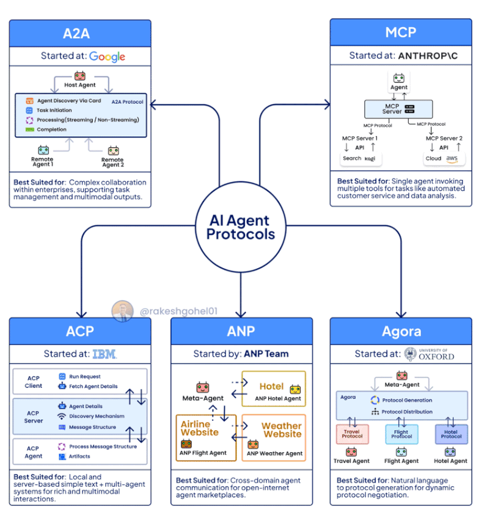
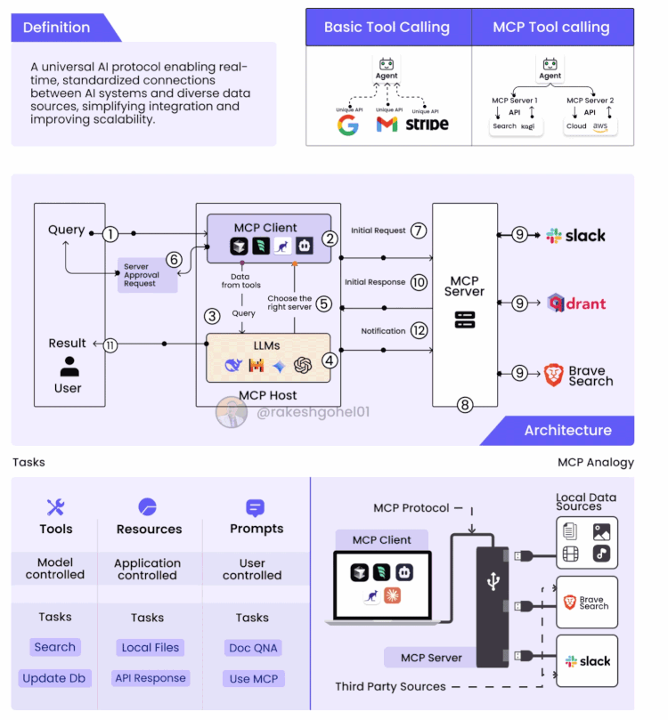
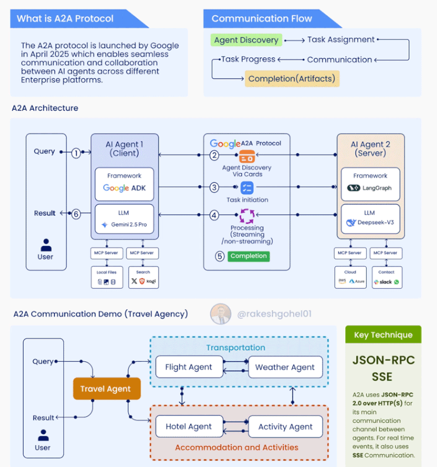

# Protocols and Interoperability

Protocols define how agents, tools, models, data sources, and other agents communicate. In system design, protocols are not just integration details; they are trust boundaries.

This page focuses on MCP, A2A-style agent communication, protocol gateways, and production security.

## Why Protocols Matter

Without standard protocols, every model-tool-agent integration becomes custom glue.

Protocols help with:

- Tool discovery.
- Structured inputs and outputs.
- Context/resource access.
- Agent-to-agent delegation.
- Auth and identity propagation.
- Observability.
- Governance and reuse.

They also expand the attack surface, because the agent can now reach more systems.

## MCP: Model Context Protocol

MCP standardizes how an AI application connects to tools, resources, prompts, and data sources.

Conceptual roles:

| Role | Responsibility |
|------|----------------|
| Host | The application or assistant using tools/resources. |
| Client | The connector inside the host that speaks MCP. |
| Server | The external service exposing tools/resources through MCP. |

Typical flow:

```text
agent host
  -> MCP client
  -> MCP server
  -> tool/resource/data source
  -> result
  -> agent reasoning loop
```

Use MCP for:

- File systems.
- Databases.
- GitHub/issues/repos.
- Internal APIs.
- Search systems.
- Knowledge bases.
- Business tools.
- Code or browser tools.

## A2A-Style Agent Communication

Agent-to-agent communication covers delegation, collaboration, handoff, and artifact exchange between agents.

Typical flow:

```text
supervisor agent
  -> task message
  -> specialist agent
  -> artifact / result / clarification
  -> supervisor synthesis or next delegation
```

Use A2A-style patterns when:

- Agents represent different roles or domains.
- Agents need different tools or permissions.
- Work can run in parallel.
- One system delegates to another owned system.
- Outputs are artifacts, not just chat messages.

Avoid agent-to-agent protocols when a simple function call, queue job, or deterministic workflow is enough.

## MCP vs A2A

| Protocol Type | Main Job | Boundary |
|---------------|----------|----------|
| MCP | Connect agents/apps to tools, resources, prompts, and data. | Agent-to-tool / agent-to-context |
| A2A-style communication | Let agents discover, delegate, exchange messages, and return artifacts. | Agent-to-agent |

In many systems both appear together: agents communicate with other agents, and each agent uses MCP-style tools.

## Production Gateway Pattern

Put a gateway between the agent runtime and protocol servers.

```text
agent runtime
  -> protocol gateway
  -> auth and identity propagation
  -> policy engine
  -> schema validation
  -> rate limit and budget check
  -> MCP server or remote agent
  -> audit log and trace event
```

The gateway should enforce:

- Tool and agent allowlists.
- User, tenant, task, and action-scoped permissions.
- Input and output schema validation.
- Timeouts and retries.
- Cost and call-count budgets.
- PII and secret scanning.
- Human approval for sensitive actions.
- Audit logs for every cross-boundary call.

## Protocol Threat Model

| Threat | Example | Control |
|--------|---------|---------|
| Prompt injection | Retrieved webpage tells agent to leak data. | isolate tool output, instruction hierarchy, untrusted-text scanning |
| Tool poisoning | Malicious tool mimics a trusted tool. | signed registries, allowlists, provenance |
| Over-permission | Calendar tool can also email external users. | least privilege, separate read/write scopes |
| Cross-tool exfiltration | Agent reads private docs, then posts to chat. | data-flow policy, approvals, DLP checks |
| Agent impersonation | Remote agent claims a false identity. | authentication, signed metadata, agent registry |
| Runaway delegation | Agents recursively call each other. | max depth, budget caps, cycle detection |
| Silent side effects | Tool changes data without approval. | dry-run mode, approvals, idempotency keys |

## Observability

Protocol calls should show up in traces.

Log:

- Trace ID and task ID.
- User and tenant.
- Tool/server/agent name.
- Input arguments.
- Output schema and status.
- Latency.
- Cost if applicable.
- Permission decision.
- Approval decision.
- Error and retry state.

## Design Checklist

- Which tools or agents are trusted, semi-trusted, or untrusted?
- What identity is propagated to each call?
- Are permissions scoped by user, tenant, task, and action?
- Are read tools separated from write tools?
- Can a tool send data outside the tenant?
- Are tool outputs treated as data rather than instructions?
- Are all calls logged with trace IDs?
- Are budgets enforced across nested calls?
- Is there a kill switch or draft-only mode?
- How are protocol servers versioned, reviewed, and retired?

## Code Examples

Small MCP examples currently live in this folder:

- [MCP calculator tool](./mcp_calculator_tool.py)
- [Claude MCP tool example](./mcp_tool_claude.py)

These examples will move to the hands-on appendix later.

## Visual Notes






