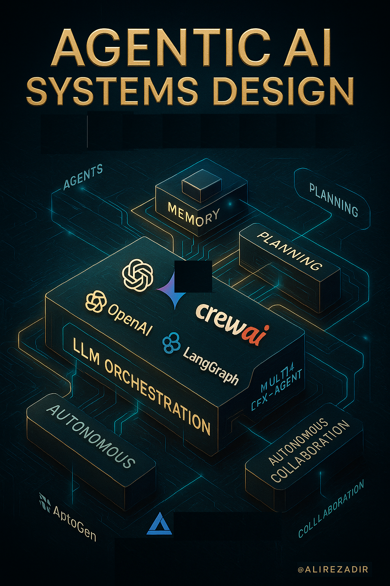

# Agentic AI Systems

> **A comprehensive guide to building production-ready AI agents and multi-agent systems**

Welcome to **Agentic-AI-Systems**, a curated and evolving book-style guide for learning GenAI foundations, agentic system design, and production-ready AI agent engineering. The repo is being refactored into cohesive chapters: foundations first, then system design, then production, use cases, and hands-on appendices.

## Contents

| Chapter | Description |
|---------|-------------|
| **[1. Foundations](./01_foundations/README.md)** | GenAI foundations and agentic AI fundamentals: FMs, LLMs, VLMs, diffusion models, prompting, RAG, agents, tools, planning, memory, and multi-agent systems. |
| **[2. GenAI & Agentic System Design](./03_system_design/README.md)** | Signature system-design chapter for compound AI systems, RAG, agentic systems, multimodal systems, coding agents, evals, security, protocols, memory, cost/latency trade-offs, and interview prep. |
| **3. From Prototype to Production** | New production chapter covering product scoping, runtime architecture, data/privacy, tool gateways, memory, evals, observability, deployment, scaling, AWS/Bedrock/AgentCore, and cost optimization. |
| **[4. Use Cases](./04_use_cases/README.md)** | Case studies and architecture walkthroughs, from simple demos to production-grade agent applications. Runnable code will move to the hands-on appendix over time. |
| **5. Hands-On Appendix** | Runnable tutorials, framework examples, starter projects, and code snippets. Current hands-on material still lives across [02_frameworks](./02_frameworks/README.md) and [04_use_cases](./04_use_cases/README.md) during migration. |
| **[Resources](./RESOURCES.md)** | Curated courses, cookbooks, tools, papers, protocols, and reference links. Kept outside the chapter sequence. |

## Refactor Roadmap

This repo is being refactored one chapter at a time:

1. Foundations: reorganize GenAI and agentic AI concepts into a cohesive book chapter.
2. System Design: make the agentic and GenAI system-design material self-contained and interview-ready.
3. Production: add a new prototype-to-production chapter with cloud, runtime, eval, observability, data, security, and cost guidance.
4. Use Cases: separate conceptual case studies from runnable examples.
5. Hands-On Appendix: centralize explicit tutorials and code.

## Highlights

#### Foundations
- **[GenAI Foundations](./01_foundations/genai-foundations.md):** Compact review of foundation models, LLMs, VLMs, diffusion models, embeddings, prompting, RAG, evals, and fine-tuning.
- **[Agentic AI Foundations](./01_foundations/agentic-ai-foundations.md):** Core concepts for agents, tools, memory, planning, human checkpoints, multi-agent systems, protocols, and reliability.
- **[Multimodal and VLM Foundations](./01_foundations/multimodal-vlm-foundations.md):** Foundations for vision-language models, documents, screenshots, audio, video, multimodal RAG, and computer-use inputs.
- **[Diffusion and Generative Media Foundations](./01_foundations/diffusion-foundations.md):** Foundations for image, video, audio, design generation, media controls, evaluation, and governance.
- **[AI Engineering Book Summary](./01_foundations/ai-engineering-summary/README.md):** GenAI system workflows and infrastructure.

#### Agentic AI Systems
- **[Agentic AI Design Patterns](./03_system_design/design-patterns/agentic-ai-design-patterns.md):** A comprehensive overview of reusable design patterns in GenAI and agentic AI systems.
- **[2026 Agentic AI System Design Update](./03_system_design/2026-agentic-ai-system-design.md):** Current framing for harness engineering, long-running agents, AgentOps, context engineering, MCP/A2A, security, and cost-aware design.
- **[RAGs](./03_system_design/RAGs/README.md):** A comprehensive overview of RAG architectures, including basic RAGs, agentic RAGs, multi-modal RAGs, and advanced RAGs.
- **[Cookbooks](./03_system_design/cookbooks/README.md):** A comprehensive overview of the most useful cookbooks in designing and building agentic AI systems.
- **[OpenAI Agents](./02_frameworks/1_openai/README.md):** Comprehensive guides, tutorials, and code examples for building AI agents using the OpenAI API and Agents SDK.
- **[Architectures](./03_system_design/architectures/README.md):** A comprehensive overview of architectures in agentic AI systems, including architecture layers, AI-native architectures, step-by-step system design, and example architectures used by tech companies.
- **[Agentic AI Evaluation](./03_system_design/evals/agentic-ai-evals.md):** A comprehensive overview of evaluating Agentic AI Systems, including evaluation layers, dimensions, methods, and frameworks.
- **Code Examples:** Step-by-step guides, example codes, and tutorials for building agentic workflows with OpenAI Agents, LangGraph, LangChain, CrewAI, LlamaIndex, and more.
- **[Multi-Agent Systems Examples](./02_frameworks/4_llamaindex/llamaindex-multi-agent-workflow.md):** Building multi-agent systems using LlamaIndex, Crew AI, and more. 
<!-- - **[Real-World Use Cases](./04_use_cases/README.md):** Example projects and applications of agentic AI in production. -->
- **[Resource Library](./RESOURCES.md):** Curated list of courses, tools, protocols, and further reading.

#### Compound GenAI Systems
- **[GenAI Systems Overview](./01_foundations/gen-AI/huyen-Gen-AI-Platform.md):** Platform architecture and technical breakdowns.
- **[GenAI and Agentic System Design Interview Prep](./03_system_design/interview-prep/genai-agentic-system-design.md):** Practice templates for production-minded system-design interviews.

## Why Agentic-AI-Systems?

- **Practical:** Real code, real projects, real-world patterns
- **Curated:** Only the most useful frameworks, tools, and concepts
- **Reference-first:** Designed for quick lookup and deep dives
- **Production-ready:** Tested examples with deployment guides
- **Community-driven:** Continuously updated with latest best practices

## Contributing

>  *More coming soon  contributions welcome!* You can start by forking and submitting your own code-based experiments.

Pull requests are welcome! If you'd like to add new frameworks, examples, or summaries, fork the repo and submit a PR.

Made with love by [Alireza Dirafzoon](https://github.com/alirezadir).
